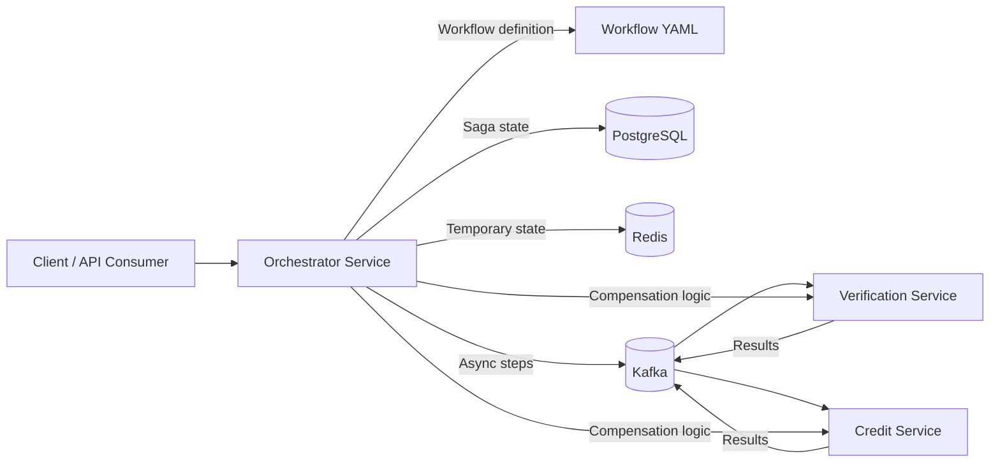
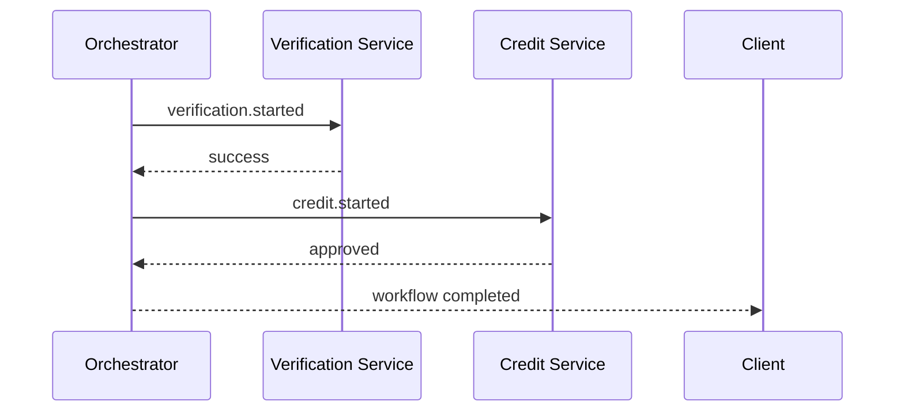
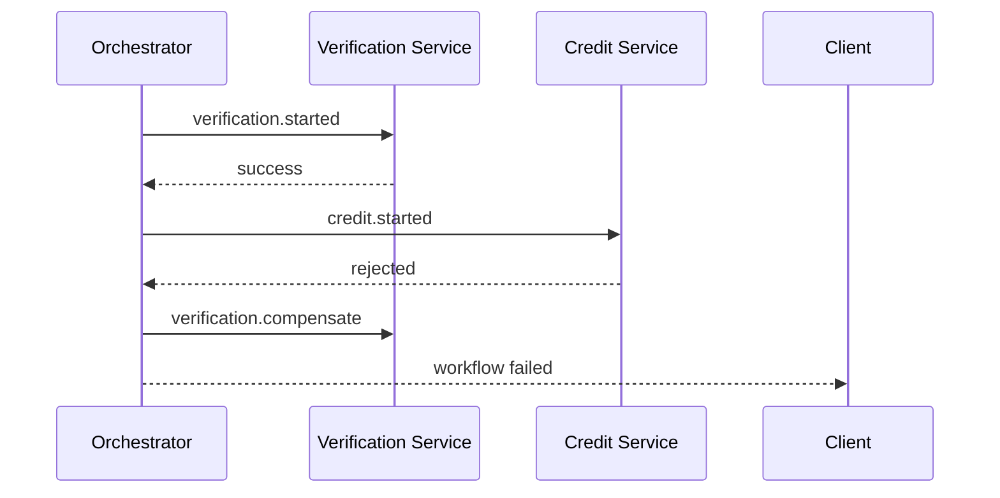

# FlowMaster — Distributed Task Orchestrator

FlowMaster is a Node.js-based orchestration backend for distributed workflow processing. The repository demonstrates a microservice-oriented design for an identity verification and credit approval saga, using Express for API endpoints, YAML to define workflows, and Docker Compose to provision local infrastructure.

## What is implemented

This project includes:

- A workflow definition loader and validator for YAML-based orchestration.
- An orchestrator service with REST endpoints for creating and querying workflows.
- In-memory workflow state tracking suitable for unit and API validation.
- Verification and credit services as independent service boundaries.
- Structured logging, Prometheus-compatible metrics, and OpenTelemetry initialization hooks.
- Docker Compose definitions for PostgreSQL, Redis, Kafka, and the three services.
- Unit tests for workflow validation and API behavior.

## Architecture overview



## Service responsibilities

### Orchestrator

- Accepts workflow submissions through REST.
- Loads and validates YAML workflow definitions.
- Maintains workflow lifecycle state and event history in memory for the current testable implementation.
- Publishes step events and coordinates the saga sequence.
- Handles validation and status responses.

### Verification service

- Simulates identity verification decisions.
- Accepts verification requests and returns approved or rejected outcomes.
- Demonstrates idempotent result handling patterns.

### Credit service

- Simulates credit score and approval decisions.
- Accepts workflow-based credit checks and returns approved or rejected results.
- Demonstrates duplicate-safe processing for event-driven workflows.

## Workflow definition

The YAML workflow is defined in [workflows/kyc-workflow.yaml](workflows/kyc-workflow.yaml):

```yaml
name: kyc-workflow
version: "1.0"
steps:
  - name: verification
    service: verification
    event: verification.started
    timeoutMs: 5000
    retries: 2
    compensation:
      service: verification
      event: verification.compensate
  - name: credit-check
    service: credit
    event: credit.started
    timeoutMs: 5000
    retries: 2
    compensation:
      service: credit
      event: credit.compensate
  - name: approval
    service: orchestrator
    event: approval.finalized
    timeoutMs: 4000
    retries: 1
```

## Saga example

### Success path



### Failure path



## API endpoints

### Submit a workflow

```bash
curl -X POST http://localhost:3001/workflows \
  -H "Content-Type: application/json" \
  -d '{"customerId":"cust-123","amount":2500}'
```

Example response:

```json
{
  "workflowId": "wf_1720000000000_ab12cd34",
  "status": "pending",
  "message": "Workflow accepted and queued for processing"
}
```

### Get workflow status

```bash
curl http://localhost:3001/workflows/<workflowId>
```

### Get event history

```bash
curl http://localhost:3001/workflows/<workflowId>/events
```

### Health checks

```bash
curl http://localhost:3001/health
curl http://localhost:3001/ready
```

## Local development

### Prerequisites

- Docker Desktop with Docker Compose, or Docker Engine with the Compose plugin.
- Node.js 20+ and npm for running tests or starting the services directly on the host.

### Recommended: run the full stack with Docker Compose

From the repository root, start PostgreSQL, Redis, Kafka, and all three application services:

```powershell
docker compose up --build -d
```

Check that the containers are running and inspect logs if needed:

```powershell
docker compose ps
docker compose logs -f orchestrator verification credit
```

The API services are available at:

- Orchestrator: `http://localhost:3001`
- Verification: `http://localhost:3002`
- Credit: `http://localhost:3003`

Submit a sample workflow and query its status from PowerShell:

```powershell
$workflow = Invoke-RestMethod -Method Post -Uri "http://localhost:3001/workflows" -ContentType "application/json" -Body '{"customerId":"cust-123","amount":2500}'
$workflowId = $workflow.workflowId
$workflow
Invoke-RestMethod -Uri "http://localhost:3001/workflows/$workflowId"
Invoke-RestMethod -Uri "http://localhost:3001/workflows/$workflowId/events"
```

Check the orchestrator health endpoints:

```powershell
Invoke-RestMethod -Uri "http://localhost:3001/health"
Invoke-RestMethod -Uri "http://localhost:3001/ready"
```

Stop the services and infrastructure when finished:

```powershell
docker compose down
```

PostgreSQL data is kept in a Docker volume when you run `docker compose down`. To remove that data as well, run `docker compose down --volumes`.

### Alternative: run application services on the host

Use this option when you want to run Node.js directly while keeping PostgreSQL, Redis, and Kafka in Docker. Run these commands from the repository root:

```powershell
Copy-Item .env.example .env
npm install
docker compose up -d postgres redis kafka
```

Start each service in a separate terminal from the repository root:

```powershell
npm run start:orchestrator
```

```powershell
npm run start:verification
```

```powershell
npm run start:credit
```

The `.env.example` file contains local connection defaults for this development setup. The credentials in it are for local development only.

## Testing

The project uses Jest and Supertest for automated validation.

```bash
npm test
```

If dependencies are not installed yet, run `npm install` first.

The test suite covers:

- valid workflow definition loading
- invalid YAML validation errors
- workflow creation state
- API validation failure responses
- service health endpoint behavior

## Project structure

```text
flowmaster/
├── .env.example
├── .gitignore
├── docker-compose.yml
├── package.json
├── README.md
├── database/
│   └── init.sql
├── services/
│   ├── orchestrator/
│   │   ├── Dockerfile
│   │   ├── package.json
│   │   └── src/
│   │       ├── app.js
│   │       └── server.js
│   ├── verification/
│   │   ├── Dockerfile
│   │   ├── package.json
│   │   └── src/
│   │       ├── app.js
│   │       └── server.js
│   └── credit/
│       ├── Dockerfile
│       ├── package.json
│       └── src/
│           ├── app.js
│           └── server.js
├── shared/
│   ├── logger.js
│   ├── metrics.js
│   ├── tracing.js
│   └── workflow-definition.js
├── tests/
│   └── unit/
│       ├── workflow-saga.test.js
│       └── api-validation.test.js
└── workflows/
    └── kyc-workflow.yaml
```

## Reliability and observability notes

The project includes:

- `pino` logging configuration.
- `prom-client` metrics for workflow totals and latency.
- `@opentelemetry/sdk-node` initialization hooks for tracing.
- `Joi` validation for external request payloads.

## Known limitations and follow-ups

This implementation intentionally focuses on the core engineering structure and testable behavior for a distributed orchestration backend. The local validation stack demonstrates the service boundary design and workflow validation, while the Docker and infra files provide the expected deployment layout for PostgreSQL, Redis, and Kafka.

The current implementation is designed as a solid foundation rather than a full production-grade Kafka/Postgres cluster deployment. Production hardening work would include:

- real Kafka consumer groups and retry/dead-letter handling
- durable PostgreSQL state and transactional outbox processing
- Redis-backed workflow cache and recovery state
- crash recovery and saga compensation replay logic
- integration tests against live Kafka and Postgres services

## Final note

The repository is organized so that the core workflow, service segregation, validation, and API behavior are executable and testable in a standard Node.js environment. Full distributed-cluster validation depends on a working Docker environment and broker infrastructure, which is configured in the repository but not executed here.
